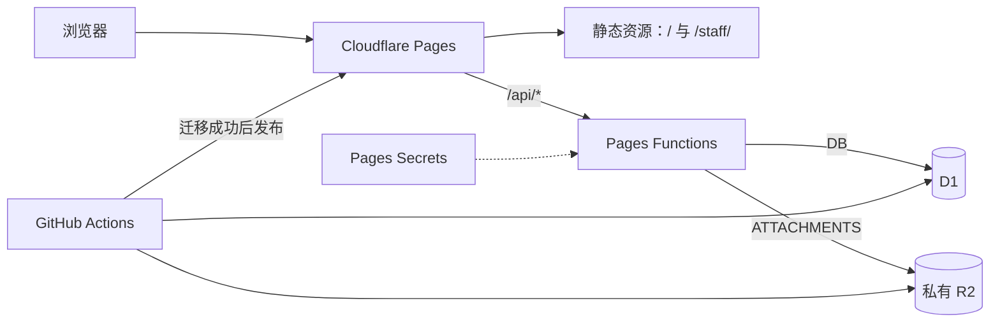

# 先锋硬件部维修预约系统

面向南湖、浑南校区的免费维修预约系统，支持预约、排队、接单、维修记录、统计和附件。学生免注册；工作人员使用账号密码登录。

项目由一个 Cloudflare Pages 项目组成，包含用户端 `/`、工作人员端 `/staff/` 和同源 `/api/*`。Pages Functions 执行业务逻辑，D1 保存业务数据，私有 R2 保存附件。项目没有独立的 Cloudflare Worker；应用使用自身的 JWT/RBAC 鉴权，不依赖 Cloudflare Access。

GitHub Actions 在所有分支推送和 PR 上运行验证：`main` 发布 Production，`dev` 发布共享 Preview，`next/staff-platform` 发布独立 Staff Staging；`feat/staff-*` 只进行隔离验证。其他分支继续发布各自的共享 Preview 地址。只有 `dev` 自动迁移共享测试库；Production 与 Staff Staging 均在目标 D1 迁移成功后发布。

发布、迁移和维护凭证分别保存在 GitHub Environments 中。附件清理和无人到场预约处理从 `main` 执行；默认分支 `dev` 上的定时入口使用 GitHub 内置 Token 派发任务，Preview 维护使用独立的受限环境和凭证。

- [业务规则与权限](docs/requirements.md)
- [工作人员白名单与自主激活](docs/staff-activation.md)
- [数据库结构](docs/data-model.md)
- [学生预约访问](docs/student-access.md)
- [部署与运维](docs/operations.md)
- [长期集成分支与 Staff Staging](docs/staff-staging.md)

## Cloudflare 架构



`public/_routes.json` 只把 `/api` 和 `/api/*` 交给 Pages Functions，其余请求返回静态资源。浏览器不直连 D1 或 R2；附件只能通过经过鉴权的 API 访问。

| 环境 | 分支 | D1 | R2 | 限额 |
|---|---|---|---|---|
| Production | `main` | `pioneer-appointments-production-v2` | `pioneer-attachments-production-v2` | 8 GiB |
| Preview | dev 和其他普通分支 | `pioneer-appointments-preview-v2` | `pioneer-attachments-preview-v2` | 512 MiB |
| Staff Staging | `next/staff-platform` | `pioneer-appointments-staff-staging` | `pioneer-attachments-staff-staging` | 512 MiB |

绑定名固定为 `DB` 和 `ATTACHMENTS`。JWT 签名密钥和联系方式加密密钥分别配置在两个 Pages 环境的 Secrets 中。

## 本地运行

需要 Node.js 22+：

```bash
npm ci
npx playwright install chromium
npm run setup:local
npm run dev
```

打开 [用户端](http://127.0.0.1:8788/) 或 [工作人员端](http://127.0.0.1:8788/staff/)，健康检查为 `/api/health`。`setup:local` 会生成随机 `.dev.vars`、应用初始迁移并初始化 `root001`、`root002`；密码保存在该文件中，不写入日志或 Git。

`.dev.vars`、`.wrangler/`、`dist/` 和测试输出均不提交。停止本地服务不会影响任何远程资源。

预约布局模拟：运行 `npm run preview:booking-layout`，打开 `http://127.0.0.1:8790/`，可调整日期、时段、屏幕尺寸和名额；使用模拟数据并禁用提交，不进入正式构建。回归检查运行 `npm run test:booking-layout`。

## 代码结构

| 位置 | 职责 |
|---|---|
| [frontend/user/](frontend/user/) | 学生预约、查询、取消和附件 |
| [frontend/staff/](frontend/staff/) | 工作人员登录、预约处理、激活和账号管理 |
| [shared/](shared/) | 公共 API、状态、时间、附件和样式 |
| [functions/api/](functions/api/) | Pages Functions API 入口 |
| [src/routes/](src/routes/) | HTTP 路由适配 |
| [src/services/](src/services/) | 业务、权限和事务编排 |
| [src/db/](src/db/) | D1 仓库与 SQL |
| [src/lib/](src/lib/) | JWT、密码、加密和校验 |
| [migrations/](migrations/) | D1 schema 与迁移 |
| [scripts/](scripts/) | 构建、测试、部署和维护命令 |

构建产物只包含静态资源；Functions 随 Pages 一起发布。数据库迁移由显式命令执行，运行时不会自动迁移或初始化账号。

## 常用检查

```bash
npm run verify
npm test
npm run test:e2e
npm run preview:local
npm run smoke
```

发布前先查看计划：

```bash
npm run release:plan -- --preview
npm run release:plan
```

远程迁移、root 初始化和 Pages 发布命令默认只打印计划；实际执行命令、Secrets、备份和附件清理见 [部署与运维](docs/operations.md)。

## API 速查

工作人员请求使用 `Authorization: Bearer <JWT>`。学生使用浏览器保存的预约访问凭证；凭证放在私人链接的 URL fragment 中，服务端只保存哈希。

| 方法 | 路径 | 用途 |
|---|---|---|
| GET | `/api/health` | 检查 D1 与 R2 |
| POST | `/api/auth/login`、`/api/auth/logout` | 登录、撤销会话 |
| GET | `/api/auth/me` | 当前账号 |
| PATCH / POST | `/api/auth/password` / `/api/auth/revoke` | 本人改密 / 撤销全部会话 |
| POST / GET | `/api/activation` / `/api/activation/:id` | 提交激活 / 凭回执查询审核状态 |
| GET / POST | `/api/appointments` | 工作人员列表 / 学生创建预约 |
| GET | `/api/appointments/:id` | 凭预约访问凭证查询 |
| POST | `/api/appointments/:id/credential` | 管理员核验后重签凭证 |
| PATCH | `/api/appointments/:id/status` | 状态、接单、维修记录或学生取消 |
| GET / POST | `/api/appointments/:id/attachments` | 附件列表 / 上传 |
| GET | `/api/appointments/:id/attachments/:attachmentId` | 附件下载 |
| GET | `/api/live/summary` | 公开名额和个人排队信息 |
| GET / PATCH | `/api/slot-capacities` | admin+ 查询 / 更新授权校区的时段人数配置 |
| GET | `/api/stats/summary`、`/api/stats/fault-types` | admin+ 统计 |
| GET | `/api/users` | admin+ 账号列表 |
| PATCH | `/api/users/:account` | 管理低于自身且非保护账号 |
| GET / POST | `/api/staff-whitelist` / `/api/staff-whitelist/import` | 名册与 CSV 导入 |
| GET / POST | `/api/activation-requests` / `/api/activation-requests/review` | 申请审核 |
| GET | `/api/export/appointments.csv` | admin+ 导出 |

学生的查询、取消、排队和附件接口都要求预约访问凭证；预约编号仅用于展示和业务沟通，不能单独访问敏感数据。

新预约编号为 `reserve{校区代码}{预约日期YYYYMMDD}-{序号}`，全流程复用，不再生成独立维修编号。历史编号保留并支持查询，主键和数据关联不变，详见 [业务规则](docs/requirements.md) 和 [数据库结构](docs/data-model.md)。

管理员可在工作人员端“个人设置 → 预约人数设置”调整容量，业务规则见 [预约规则](docs/requirements.md#预约规则)。

`GET /api/slot-capacities` 返回 `{ items: [{ campus, timeSlot, capacity, revision }] }`，只包含授权校区。PATCH 接受单项同形对象，capacity 为非负安全整数，revision 必须匹配当前版本；成功返回更新项并递增 revision，冲突返回 409，权限不足返回 403。

`GET /api/live/summary` 返回各时段占用人数 `slots` 和容量 `slotCapacities`；选校区时返回该校区数据，否则汇总两个校区。`capacity` 与 `slotTotal` 使用相同筛选范围：选时段时返回该时段容量，否则合计两个时段；凭预约查询时默认采用该预约的校区、时段。暂停或满额时预约写入返回 409。
