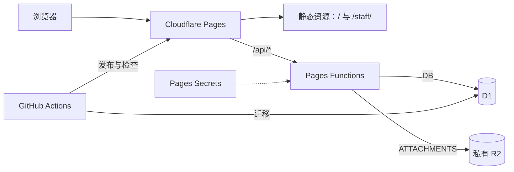

# 先锋硬件部维修预约系统

面向南湖、浑南校区的免费维修预约系统，提供学生预约与查询、工作人员现场维修、排班、考勤和成员授权管理。

学生端使用原生 HTML/CSS/JavaScript，工作人员端使用 React、TypeScript 与 Vite。入口为学生端 `/`、工作人员端 `/staff/` 和同源 `/api/*`。

## Cloudflare 架构



[路由配置](public/_routes.json) 只将 `/api` 和 `/api/*` 交给 Functions；浏览器通过鉴权 API 访问数据库和附件。

| 环境 | 分支 | 配置 |
| --- | --- | --- |
| Production | `main` | [wrangler.jsonc](wrangler.jsonc) |
| 共享 Preview | `dev` 及普通功能分支 | 同文件的 `env.preview` |
| Staff Staging | `next/staff-platform` | [wrangler.staff-staging.jsonc](wrangler.staff-staging.jsonc) |

三套环境独立保存数据、附件与密钥；普通 Preview 分支共用测试资源。推送会触发 CI，`main`、`dev`、`next/staff-platform` 验证后迁移并发布；`feat/staff-*` 仅验证，其他分支发布 Preview 且不迁移。**`main` 为生产分支，推送和远程操作须明确授权。**

## 本地运行

需要 Node.js 22.18+：

```bash
npm ci
npx playwright install chromium webkit
npm run setup:local
npm run dev
```

访问 [学生端](http://127.0.0.1:8788/) 或 [工作人员端](http://127.0.0.1:8788/staff/)。本地密钥和管理员密码位于 `.dev.vars`，数据位于 `.wrangler/`；初始化不覆盖已有密码。

| 命令 | 用途 |
| --- | --- |
| `npm run verify` | 格式、lint、类型、架构、构建、测试与迁移检查 |
| `npm run preview:local` | 隔离本地 D1/R2 预览，地址由终端输出 |
| `npm run preview:field` | 带工作人员流程夹具的隔离预览 |
| `npm run preview:booking-layout` | 8790 端口预约布局预览，模拟数据、禁用提交 |
| `npm run test:booking-layout` | 预约布局回归 |
| `npm run release:plan -- --staff-staging` | 查看 Staff Staging 发布计划，不执行远程操作 |

## 文档

- [业务规则与权限](docs/requirements.md)：预约、维修、激活、排班与考勤。
- [数据模型](docs/data-model.md)：持久化约束、迁移与兼容。
- [部署与运维](docs/operations.md)：环境、Secrets、发布、维护与备份。
- [模块与工程约定](docs/architecture/module-map.md)：模块边界、事务和前端协作。
- [身份与组织映射](docs/architecture/identity-mapping.md)、[授权与字段范围](docs/architecture/authorization.md)、[签到策略](docs/architecture/attendance-policies.md)。

API 以 [路由](src/routes/)、[平台契约](docs/contracts/staff-platform.json) 和 [模块清单](src/modules/registry.js) 为准；迁移和模块指纹由 [基线清单](docs/contracts/baseline-manifest.json) 校验。
