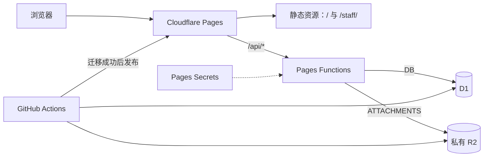

# 先锋硬件部维修预约系统

面向南湖、浑南校区的免费维修预约系统，提供学生预约与查询、工作人员扫码签到与维修记录、管理员账号及预约管理。

学生端使用原生 HTML/CSS/JavaScript，工作人员平台使用 React、TypeScript 与 Vite；Cloudflare Pages Functions 提供 API，D1 保存业务数据，私有 R2 保存附件。入口为学生端 `/`、工作人员端 `/staff/` 和同源 `/api/*`。工作人员端由 React 独立处理登录、激活、会话和导航；合入 dev 后自动迁移现有 Preview 数据库并部署，无需环境开关。

GitHub Actions 在所有分支推送和 PR 上运行验证：`main` 发布 Production，`dev` 发布共享 Preview，`next/staff-platform` 发布独立 Staff Staging；`feat/staff-*` 只进行隔离验证。其他分支继续发布各自的共享 Preview 地址。只有 `dev` 自动迁移共享测试库；Production 与 Staff Staging 均在目标 D1 迁移成功后发布。

发布、迁移和维护凭证分别保存在 GitHub Environments 中。附件清理和无人到场预约处理从 `main` 执行；默认分支 `dev` 上的定时入口使用 GitHub 内置 Token 派发任务，Preview 维护使用独立的受限环境和凭证。

- [业务规则与权限](docs/requirements.md)
- [工作人员白名单与自主激活](docs/staff-activation.md)
- [数据库结构](docs/data-model.md)
- [学生预约访问](docs/student-access.md)
- [部署与运维](docs/operations.md)
- [工作人员平台架构](docs/architecture/module-map.md)
- [身份与组织映射](docs/architecture/identity-mapping.md)
- [权限与签到契约](docs/architecture/authorization.md)
- [长期集成分支与 Staff Staging](docs/staff-staging.md)
- [本次人员平台集成的审阅、验收与已知缺口](docs/releases/staff-platform-review.md)

## Cloudflare 架构



`public/_routes.json` 只把 `/api` 和 `/api/*` 交给 Pages Functions，其余请求返回静态资源。浏览器不直连 D1 或 R2；附件只能通过经过鉴权的 API 访问。

| 环境 | 分支 | D1 | R2 | 限额 |
|---|---|---|---|---|
| Production | `main` | `pioneer-appointments-production-v2` | `pioneer-attachments-production-v2` | 8 GiB |
| Preview | dev 和其他普通分支 | `pioneer-appointments-preview-v2` | `pioneer-attachments-preview-v2` | 512 MiB |
| Staff Staging | `next/staff-platform` | `pioneer-appointments-staff-staging` | `pioneer-attachments-staff-staging` | 512 MiB |

绑定名固定为 `DB` 和 `ATTACHMENTS`。JWT 签名密钥和联系方式加密密钥分别配置在两个 Pages 环境的 Secrets 中。

## 本地运行

需要 Node.js 22.18+（本地测试直接运行 TypeScript 排班模块）：

```bash
npm ci
npx playwright install chromium webkit
npm run setup:local
npm run dev
```

访问 [学生端](http://127.0.0.1:8788/) 或 [工作人员端](http://127.0.0.1:8788/staff/)。本地配置和管理员密码在 `.dev.vars`，数据在 `.wrangler/`；初始化不覆盖已有密码。

| 命令 | 用途 |
|---|---|
| `npm run verify` | 代码、架构、单元/集成、迁移与浏览器检查 |
| `npm run preview:local` | 使用独立本地数据库和附件存储的预览 |
| `npm run preview:booking-layout` | 8790 端口布局预览，模拟数据、禁用提交 |
| `npm run test:booking-layout` | 预约布局回归 |

页面位于 `frontend/`，公共配置与校验位于 `shared/`；API 按 `functions/api/` → `src/routes/` → `src/services/` → `src/db/` 分层。

## 文档

```bash
npm run verify
npm test
npm run test:e2e
npm run preview:local
npm run smoke
```

发布前先查看计划：

```bash
npm run release:plan -- --preview
npm run release:plan
```

远程迁移、root 初始化和 Pages 发布命令默认只打印计划；实际执行命令、Secrets、备份和附件清理见 [部署与运维](docs/operations.md)。

## API 速查

工作人员请求使用 `Authorization: Bearer <JWT>`。学生使用浏览器保存的预约访问凭证；凭证放在私人链接的 URL fragment 中，服务端只保存哈希。

| 方法 | 路径 | 用途 |
|---|---|---|
| GET | `/api/health` | 检查 D1 与 R2 |
| POST | `/api/auth/login`、`/api/auth/logout` | 登录、撤销会话 |
| GET | `/api/auth/me` | 当前账号 |
| PATCH / POST | `/api/auth/password` / `/api/auth/revoke` | 本人改密 / 撤销全部会话 |
| POST / GET | `/api/activation` / `/api/activation/:id` | 提交激活 / 凭回执查询审核状态 |
| GET / POST | `/api/appointments` | 工作人员列表 / 学生创建预约 |
| GET | `/api/appointments/:id` | 凭预约访问凭证查询 |
| POST | `/api/appointments/:id/credential` | 管理员核验后重签凭证 |
| PATCH | `/api/appointments/:id/status` | 状态、接单、维修记录或学生取消 |
| GET / POST | `/api/appointments/:id/attachments` | 附件列表 / 上传 |
| GET | `/api/appointments/:id/attachments/:attachmentId` | 附件下载 |
| GET | `/api/live/summary` | 公开名额和个人排队信息 |
| GET / PATCH | `/api/slot-capacities` | admin+ 查询 / 更新授权校区的时段人数配置 |
| GET | `/api/stats/summary`、`/api/stats/fault-types` | admin+ 统计 |
| GET | `/api/users` | admin+ 账号列表 |
| PATCH | `/api/users/:account` | 管理低于自身且非保护账号 |
| GET / POST | `/api/staff-whitelist` / `/api/staff-whitelist/import` | 名册与 CSV 导入 |
| GET / POST | `/api/activation-requests` / `/api/activation-requests/review` | 申请审核 |
| GET | `/api/export/appointments.csv` | admin+ 导出 |

工作人员平台（dev 追加 `0010_staff_platform.sql`，Staff Staging 采用独立迁移目录，契约 schema `0022`）还提供稳定成员、模块授权、策略化签到和排班契约：`/api/members`、`/api/roles`、`/api/permissions`、`/api/workbench`、`/api/attendance/*`、`/api/presence/me`、`/api/roster-tasks`、`/api/rosters/*`、`/api/swaps`、`/api/leaves` 和 `/api/audit`。`GET /api/auth/me` 返回 `memberId`、任职、工作属性、完整授权、当日岗位、模块导航、恢复任务、`authVersion` 与 schema 版本。

学生的查询、取消、排队和附件接口都要求预约访问凭证；预约编号仅用于展示和业务沟通，不能单独访问敏感数据。

新预约编号为 `reserve{校区代码}{预约日期YYYYMMDD}-{序号}`，全流程复用，不再生成独立维修编号。历史编号保留并支持查询，主键和数据关联不变，详见 [业务规则](docs/requirements.md) 和 [数据库结构](docs/data-model.md)。

管理员可在工作人员端“预约配置”调整容量，业务规则见 [预约规则](docs/requirements.md#预约规则)。

`GET /api/slot-capacities` 返回 `{ items: [{ campus, timeSlot, capacity, revision }] }`，只包含授权校区。PATCH 接受单项同形对象，capacity 为非负安全整数，revision 必须匹配当前版本；成功返回更新项并递增 revision，冲突返回 409，权限不足返回 403。

`GET /api/live/summary` 返回各时段占用人数 `slots` 和容量 `slotCapacities`；选校区时返回该校区数据，否则汇总两个校区。`capacity` 与 `slotTotal` 使用相同筛选范围：选时段时返回该时段容量，否则合计两个时段；凭预约查询时默认采用该预约的校区、时段。暂停或满额时预约写入返回 409。
