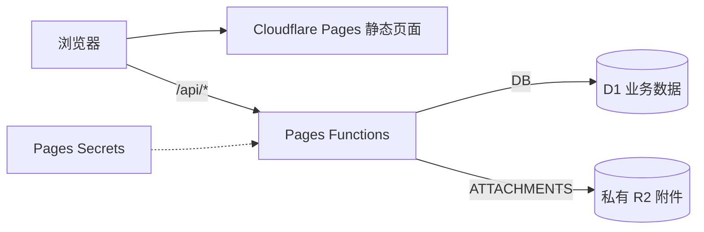

# 先锋硬件部维修预约系统

面向南湖、浑南校区的免费维修预约系统。学生免注册预约、查询和展示维修二维码；维修人员登录后扫码、拍照签到、填写维修结果；管理员保留预约、账号、统计与导出等管理功能，也可参与维修。

## 架构与环境

一个 Cloudflare Pages 项目提供用户端 `/`、工作人员端 `/staff/` 和同源 `/api/*`。静态页面使用原生 HTML/CSS/JavaScript，Pages Functions 执行业务逻辑，应用自行完成 JWT/RBAC 鉴权，不依赖 Cloudflare Access，也没有独立 Worker 项目。



浏览器通过鉴权 API 访问附件，不直连 D1/R2。`main` 为生产分支；所有非 `main` 分支发布独立 Preview 地址，共用测试 D1/R2 和 Secrets，与生产环境隔离。GitHub Actions 验证通过后发布，仅 `main` 和 `dev` 自动迁移各自数据库。推送会触发发布，须先确认目标分支与发布授权。

## 本地运行

需要 Node.js 22+：

```bash
npm ci
npx playwright install chromium
npm run setup:local
npm run dev
```

打开 [用户端](http://127.0.0.1:8788/) 或 [工作人员端](http://127.0.0.1:8788/staff/)。`setup:local` 生成随机 `.dev.vars`、应用本地迁移并初始化 `root001`、`root002`；密码保存在该文件中。已有配置和 root 密码不会被覆盖。本地数据位于 `.wrangler/`，不连接远程资源；配置、数据、构建与测试输出不提交。

## 开发与验证

- `npm run verify`：代码检查、架构检查、单元/集成测试、迁移检查与 Chromium E2E。
- `npm run preview:local`：启动本地测试预览；`npm run smoke -- https://<domain>`：检查已部署站点。
- `npm run preview:booking-layout`：在 `http://127.0.0.1:8790/` 预览预约布局，使用模拟数据、禁用提交；回归命令为 `npm run test:booking-layout`。

页面位于 [frontend/](frontend/)，公共模块位于 [shared/](shared/)。API 从 [functions/api/](functions/api/) 进入 [路由](src/routes/)，再调用 [业务服务](src/services/) 和 [D1 仓库](src/db/)；接口以路由代码为准。数据库结构由 [migrations/](migrations/) 定义，构建和运维命令位于 [scripts/](scripts/)。运行时不会迁移数据库或初始化账号。

## 必要文档

- [业务规则与权限](docs/requirements.md)：预约、扫码维修、学生凭证、账号激活。
- [数据库结构](docs/data-model.md)：实体、并发约束与历史兼容。
- [部署与运维](docs/operations.md)：Cloudflare 配置、发布、扫码回退、维护与备份。
