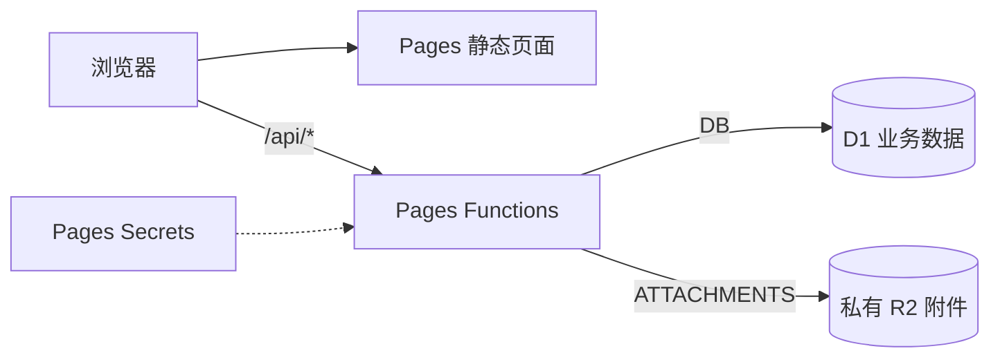

# 先锋硬件部维修预约系统

面向南湖、浑南校区的免费维修预约系统：学生免注册预约、查询和展示二维码；工作人员扫码、拍照签到、记录维修结果；管理员管理预约、账号、容量、统计与导出。

## 架构

一个 Cloudflare Pages 项目提供用户端 `/`、工作人员端 `/staff/` 和同源 `/api/*`。前端使用原生 HTML/CSS/JavaScript，Pages Functions 负责业务与 JWT/RBAC 鉴权。



附件经鉴权 API 访问。环境、分支与发布规则见 [部署运维](docs/operations.md)。

## 本地开发

需要 Node.js 22+：

```bash
npm ci
npx playwright install chromium
npm run setup:local
npm run dev
```

访问 [用户端](http://127.0.0.1:8788/) 或 [工作人员端](http://127.0.0.1:8788/staff/)。`setup:local` 初始化本地数据库与管理员，配置和密码在 `.dev.vars`，数据在 `.wrangler/`；不覆盖已有配置和密码。

| 命令 | 用途 |
|---|---|
| `npm run verify` | 代码、架构、单元/集成、迁移与 Chromium E2E 检查 |
| `npm run preview:local` | 隔离的本地测试预览 |
| `npm run preview:booking-layout` | 预约布局预览（8790 端口，模拟数据、禁用提交） |
| `npm run test:booking-layout` | 预约布局回归 |

源码：页面在 `frontend/`，公共模块在 `shared/`；API 按 `functions/api/` → `src/routes/` → `src/services/` → `src/db/` 分层。

## 文档

- [业务规则与权限](docs/requirements.md)
- [数据库结构与约束](docs/data-model.md)
- [部署、迁移、回退与维护](docs/operations.md)
- [Staff Staging 配置与运维](docs/staff-staging.md)
