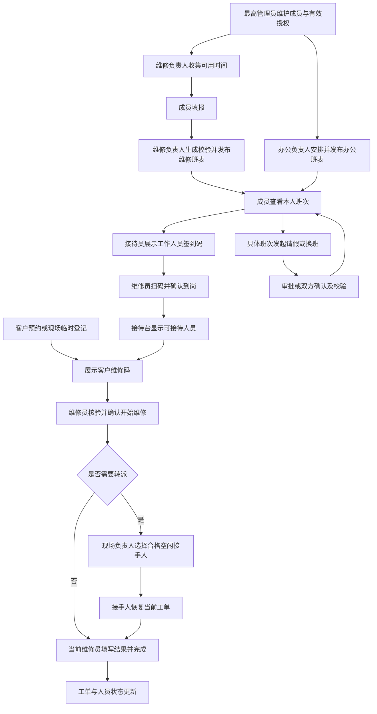

# 工作人员现场流程验收

工作人员入口为 /staff/，由 React 独立处理登录、激活、会话恢复、退出与导航。旧页面和运行时切换机制已移除。迁移、部署和自动检查见 [集成验收指南](releases/staff-platform-review.md)。

自动验证覆盖签到、扫码、核验照片、接单、转派、完成、临时登记、管理操作、会话撤销及草稿恢复。Chromium 与 WebKit 检查浏览器行为；实际摄像头、iOS Safari 和 QQ/微信内置浏览器仍需实机检查。

## 人工测试范围与准备

下列流程以当前 `next/staff-platform` 页面与接口为准。建议先在 Staff Staging 或隔离本地预览执行；这些步骤包含修改授权、发布班表和维修结果，使用测试成员与测试预约。记录实际测试提交、环境、测试日期与校区；本地预览是启动时的代码快照，更新代码后需要重新启动。

岗位与部门分开测试：部门表示组织归属，岗位和有效授权决定工作入口。同一部门可以有人仅维修、有人负责排班；跨部门兼任也必须使用实际授予的范围。不能按“硬件部必然有所有维修权限”或账号旧版管理员标签判断。

先准备同校区接待员、维修员 A/B、维修负责人、办公排班负责人、最高管理员，以及另一校区／另一部门的对照成员。上表本地预览已有前四类现场人员与 root；办公排班负责人需由 root 在测试环境通过成员角色授权配置。部署环境不自动创建上表账号，浏览器自动测试临时创建的账号也不应当作部署账号使用。

使用独立浏览器会话扮演不同人员；同一浏览器普通标签页未必能隔离登录。准备两张测试预约、设备正反面测试图片、可用于签到的二维码图片。当前日期与班次必须匹配；登记截止后不得通过更改业务规则制造当天样例，可安排下一次有效值班日测试。

## 岗位交接总览

## 各岗位操作与检查结果

### 维修人员与交流人员

1. 进入“班次与排班”，查看本人当周安排；在有权参与的收集任务中填报可用时间。切到别的模块再回来，确认日期、筛选和输入不会无故重置。
2. 值班日进入维修工作台。未到岗时应显示签到入口；扫描工作人员签到码，先核对校区、日期、窗口，再确认签到。接待员刷新后应看到该成员空闲。
3. 扫描客户维修码，或从同一扫码入口用相册／编号搜索查单。只预览不得改变签到或工单状态。工作人员签到码应进入签到确认，客户维修码应进入工单核验。
4. 核对机主、设备和故障，填写现场确认项、上传所需照片，再“确认开始维修”。预约转为维修中，本人显示当前维修；不能同时接第二单。
5. 输入维修说明，中途刷新或重新登录，应恢复当前工单及已保存的草稿。完成确认后，工单结果更新，本人恢复可接单状态。
6. 空闲时离岗，接待台不应继续把此人作为空闲接手人员；返回岗位后再恢复。进行中工单跨日后，本人仍应能继续处理，不能因当天没有新班次丢失任务。

交流人员在获得相应维修资格与授权后执行相同流程；独立的交流人员标签、资格编辑体验仍需专项验收，不把普通维修账号的测试结果替代这一项。

### 办公接待人员

1. 登录进入接待台，核对顶部校区、日期，仅出现授权范围内的选项。展示“工作人员签到码”，让维修员签到；它不应被当作客户维修凭证。
2. 查看预约与人员。点击时段、人数、状态后，检查列表确实联动到对应范围；手机切换“预约／人员”后保留查询条件。
3. 查找已有预约，查看客户维修码；对于未预约客户，进入临时登记，填写客户、设备、故障和签名，成功后展示维修码并可继续登记下一位。
4. 登记完成时检查没有自动占用维修员。线下将客户交给空闲维修员；只有维修员核验并确认接单后，工单与人员状态才改变。
5. 观察接单、转派、完成后的列表与人员变化。其他会话可手动刷新或等待约 30 秒；隐藏页暂停，返回后根据数据新鲜度更新。

### 维修排班负责人与当日维修负责人

两类职责分别测试；拥有长期排班授权不表示每天都能现场转派。

1. “维修排班管理”新建收集任务，选择周、授权校区和部门、时段及截止时间。范围选项应来自服务端；范围外的部门、校区不能通过修改请求创建。
2. 成员填报后生成草稿，查看覆盖、均衡和发布校验结果；手工调整、锁定安排，保存并校验。刷新应恢复服务端草稿。
3. 预览差异并发布。成员只在发布后看到新安排；缺少必要负责人或成员资格变化时应阻止无效发布并提示处理原因。
4. 在没有当日班次的日期登录，有长期授权者仍可提前排班；现场管理入口不得因此自动出现。
5. 当天实际担任维修负责人后，进入“现场管理”，查看人员与工单。从具体维修中工单发起转派，选择符合条件且空闲的接手人员、填写原因并确认。
6. 原维修员不再持有该当前任务，接手人显示同一工单；接待台同步。接手人完成后，双方任务、工单和人员占用一致。

### 办公排班负责人与请假审批人员

1. “办公排班管理”创建授权范围内的任务，按日期安排有资格成员和相应协调岗位；查看发布前覆盖与校验，确认后发布。
2. 办公成员从“班次与排班”看到本人安排；没有排班管理授权时不得看到管理入口。
3. 进入“请假审批”，查看待审批、已批准和已退回。打开申请，应同时看到原班次、原因、预计出勤、实际签到及批准后的覆盖影响。
4. 批准需要补位的请假后，依据提示进入有权限的排班页面安排补位；没有排班权限时应提示联系负责人。批准请假不应删除原班次及历史签到事实。
5. 退回另一份申请，填写说明，申请人应能查看结果。非值班日的长期审批权限继续有效，跨范围申请不可查看或审批。

### 所有成员的请假与换班

1. 从本人具体班次发起请假，系统自动带入时间、校区和岗位，填写原因后提交；不要求手工输入内部编号或版本号。
2. 另一份班次发起换班，选择候选人，查看交换前后的安排并提交；对方在邀请中查看后同意或拒绝。
3. 按页面提示完成所需双方确认与校验；只有成功落实的换班才能更新双方班次。拒绝、失效或资格冲突不能改变现有班表。
4. 刷新双方页面，检查申请状态与班表一致；重复确认不应再次交换；请假、换班、班表再发布相互影响时，应显示冲突并读取最新结果。

### 最高管理员

1. 在“账号管理”验证白名单、激活申请审核及账号启停；在“成员管理”核对成员资料与关联账号。账号启停和成员状态分别验证。
2. 在“授权管理”配置测试角色的校区、部门、条件和有效期，再通过成员详情分配角色。修改一个权限不能丢掉其他权限的范围、条件或有效期。
3. 普通成员登录确认只出现获授权入口；直接进入禁止页面、伪造读取与写入请求均应失败。
4. 让测试成员保持管理页面打开，管理员撤销对应权限。旧令牌的后续请求应被拒绝，客户端下一次权限／会话检查后退出受限页面或重新登录；重新登录后入口消失。
5. 在“预约配置”修改测试容量，验证草稿、保存、冲突提示及已预约日期快照；在“预约记录”核对筛选、组合排序和详情，再检查有权限的统计与导出。
6. 需要参与维修时，以实际工作资格、班次与签到状态走维修闭环；管理身份不能替代核验和接单。

## 跨部门与异常测试

| 场景 | 人工操作 | 通过条件 |
| --- | --- | --- |
| 部门隔离 | 给负责人仅授予甲部门南湖范围，对照乙部门及浑南数据 | 列表、详情、任务选项和写入均遵守范围；不能组合两条不完整授权越权 |
| 兼任 | 为同一成员授予多个有效角色，在各入口操作 | 入口依实际授权出现；任务与草稿随切换保留，岗位事实不混用 |
| 权限有效期 | 设置未来／到期角色，分别在有效期内外检查 | 授权按业务日期生效；失效后不能靠旧入口或请求继续操作 |
| 并发接单 | A/B 同时核验并提交同一张预约 | 只有一人成功，另一人得到冲突并看到最新状态 |
| 转派竞争 | 打开接手人列表后，让接手人先接其他单，再确认转派 | 转派失败且原维修关系保持，不产生双重占用 |
| 提交结果不确定 | 提交维修结果时模拟断网，恢复后查询与重试 | 输入保留，通过实际工单判断结果，不能产生重复完成记录 |
| 草稿与刷新 | 编辑后切模块、刷新、退出再登录 | 已持久化草稿可恢复；未保存内容按页面规则提示，不混入其他成员会话 |
| 隐藏与摄像头 | 开启摄像头后切模块、隐藏标签页及关闭页面 | 摄像头轨道释放；隐藏工作板停止轮询，返回后恢复必要更新 |
| 窄屏与桌面 | 320、390、1440px 执行查询、弹窗、提交、审批 | 主操作可见，文字不重叠，详情可关闭，焦点和输入不被刷新打断 |

## 首版未交付项与反馈记录

工作资格的完整编辑页面、完整多部门任职管理体验、负责人考勤管理与修正页面、完整统计／审计／数据管理、会议完整接入及真实 NFC 验收仍未完成。排班任务目录完整分页、部分任务命令的原子审计与回执也待补齐。这些记为功能缺口，不登记为“已交付但测试通过”。本地未接入的工作资格草稿不纳入此版。

每条问题记录：提交版本、环境、账号岗位与授权范围、日期校区、复现步骤、预期结果、实际结果、截图和复现频率。权限问题增加记录该账号当时的有效角色／条件；跨岗位问题说明哪一个会话已更新、哪一个未更新。不要在问题中附登录令牌、客户私人凭证或真实客户敏感资料。

## UI 一致性检查（2026-10-17）

本轮沿用现有业务和授权，仅调整页面基础结构、组件及交互呈现。未接入的工作资格草稿不在交付范围内。

| 页面范围 | 检查内容 |
| --- | --- |
| 维修工作台、接待台、现场管理 | 共用标题与范围栏；中等屏宽避免预约列表被人员侧栏挤窄 |
| 个人中心、班次与排班、本人签到记录、账号安全 | 共用内容起点；个人信息、班次与操作分区；表单左对齐 |
| 维修排班管理、办公排班管理、请假审批 | 共用工具栏、任务内容及页签；保留草稿与确认流程 |
| 成员管理、授权管理、账号管理 | 共用查询与详情结构；授权按业务分组筛选，高级配置保留 |
| 预约记录、预约配置、统计分析 | 共用标题和内容容器；宽表内部滚动、手机记录摘要 |

自动检查遍历以上 16 个入口，在 320、390、768、1440px 比较主标题坐标、字体、行高与字重，检查页面横向溢出。截图保存在本地忽略目录 `output/field-workflow/ui-consistency/`，不随源代码提交。

侧栏检查包括隐藏可见滚动条、短视口中滚动到末项、键盘聚焦和固定账号区。成员长表单检查四种屏宽下内部滚动、固定标题／关闭按钮、无横向溢出和关闭后的焦点恢复。桌面记录详情采用侧面板，手机详情全屏；简短确认保留居中对话框。

相关浏览器回归同时覆盖核验接单、转派与完成、请假换班、排班创建与发布、成员编辑、授权范围配置、账号审核、预约配置草稿与冲突、预约详情及统计。切换保留筛选、刷新保留输入、权限隐藏与拒绝访问、后台暂停和摄像头释放继续执行原有回归。真实设备和浏览器差异仍按前述人工范围验收。
