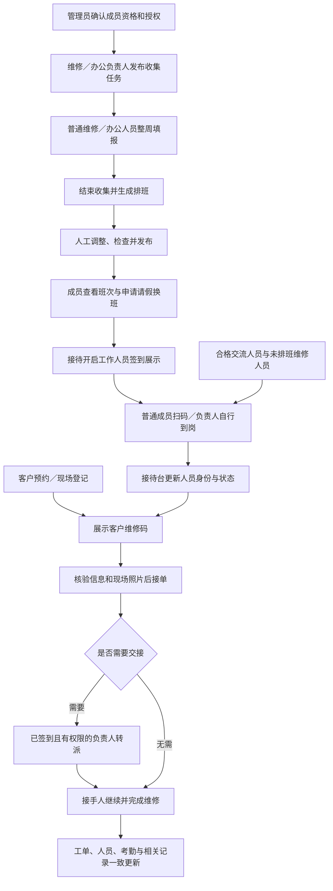

# 工作人员平台集成：审阅与验收指南

本指南描述 `next/staff-platform → dev` 的交付范围，供本次集成审阅使用。核对基线为 `dev@62ad179`、`main@bd5a9ac`；分支已包含该 dev 的全部提交。规格来源为仓库根目录的 [v1.3](../../Pioneer_Staff_Development_Spec_v1.3.md)，下述后续确认规则优先于规格中的旧约定。

这是工作人员平台的集成版本，不代表 v1.3 全部条目已完成。历史 G0/G10 状态、首个停止节点和旧 PR #57 的说明保留为实施记录；当前行为、验证范围和缺口以本指南及代码为准。

## 1. 建议审阅顺序

按下列主题分批审阅，不建议依 GitHub 的文件字母顺序通读。

| 顺序 | 审阅主题与关键文件 | 重点检查 |
| --- | --- | --- |
| 1 | [运行上下文](../../src/context.js)、[应用组合](../../src/app/compose.js)、[模块注册](../../src/modules/registry.js)、[契约](../../docs/contracts/staff-platform.json) | 新旧宿主启用边界；依赖方向；请求级数据库会话；模块契约。 |
| 2 | [身份映射](../architecture/identity-mapping.md)、[授权实现](../../src/modules/authorization/public.js)、[条件](../../src/modules/authorization/conditions.js)、[界面权限](../../shared/staff-access.js)、[身份摘要](../../shared/staff-identities.js) | memberId 与登录账号分离；同一个完整 grant 的范围交集；有效期、签到条件、客户字段及撤权。 |
| 3 | [现场流程](../../src/services/field-workflow.js)、[预约存储](../../src/db/appointments.js)、[维修页面](../../frontend/staff-react/field/Repair.tsx)、[工作台](../../frontend/staff-react/field/FieldApp.tsx) | 到岗与工单扫码区分；接单／转派／完成的原子性、回执和一人一单。 |
| 4 | [人员与排班服务](../../src/services/staff-platform.js)、[持久化](../../src/db/staff-platform.js)、[收集存储](../../src/db/roster-collection.js)、[排班算法](../../src/modules/rosters/)、[排班界面](../../frontend/staff-react/RosterWorkflow.jsx) | 两种排班的完整流程；循环周期；人工覆盖；发布竞争；签到和申请保护。大型 service/repository 仍是后续拆分重点。 |
| 5 | [考勤核算](../../src/modules/attendance/weekly-export.js)、[暂停日期](../../src/db/service-days.js)、[成员资格](../../frontend/staff-react/MemberQualifications.jsx)、[成员编辑](../../frontend/staff-react/MemberEditor.jsx) | 历史身份、实际事实与核算分离；暂停日禁止写入；资格撤销；授权不能等同维修资格。 |
| 6 | [React 入口](../../frontend/staff-react/main.jsx)、[统一侧栏](../../frontend/staff-react/StaffWorkspace.tsx)、[查询生命周期](../../frontend/staff-react/useWorkspaceQuery.js)、[页面基础样式](../../frontend/staff-react/workspace-foundation.css)、[现场共享组件](../../frontend/staff-react/field/ui.tsx) | 页面不整壳重挂载；草稿和焦点保留；隐藏页面暂停；弹窗焦点、触控尺寸、长列表与窄屏。 |
| 7 | [升级说明](../../database/upgrades/README.md)、[迁移清单和指纹](baseline-manifest.json)、[CI](../../.github/workflows/check.yml)、[发布编排](../../scripts/ci-release.mjs)、[运维](../operations.md) | 两条真实历史升级链；原库原密钥；开关；迁移先于部署；回退边界。 |

## 2. 岗位工作流程与验收矩阵

表中的“自动化”表示相应流程有真实临时 D1/R2、HTTP 或浏览器断言，不表示真实设备与全部业务场景均已人工验收。

| 岗位／范围 | 入口与交接流程 | 关键反向检查 | 验收证据 |
| --- | --- | --- | --- |
| 最高管理员 | 成员导入 → 激活审批 → 任职／资格／角色范围 → 各岗位登录 | 禁用成员与禁用账号分开；稳定 memberId；旧版本不写入；审计失败整体回滚；无授权不展示入口且 API 拒绝 | `staff-platform-http.test.mjs`、`exchange-role.test.mjs`、`staff-members.spec.mjs`、`staff-authorization.spec.mjs` |
| 普通维修人员 | 整周填报 → 查看班次 → 请假／换班 → 扫码到岗 → 查单核验 → 上传现场照片 → 接单 → 完成 | 未排班仍能扫码到岗；同人多账号不能同时接两单；并发抢单只有一人成功；跨日恢复；断网保留输入并查询结果 | `field-workflow.test.mjs`、`field-flow.spec.mjs`、`roster-flow.spec.mjs` |
| 交流人员 | 培训资格确认导入 → 激活 → 扫码到岗 → 接单维修 → 完成 | 保留真实部门与交流身份；没有排班填报、补位与换班入口；不能进入候选；资格撤销后命令与入口同时失效 | `exchange-role.test.mjs`、`staff-identities.test.mjs`、现场流程回归 |
| 办公接待 | 开启工作人员签到码 → 查看维修相关人员 → 查预约／连续临时登记 → 展示客户维修码 → 跟进处理 | 不展示整个组织名册；负责人身份独立于维修资格；空闲人数只算可接单者；登记不占用维修员；客户隐私遵守对象范围 | `field-workflow.test.mjs`、`field-flow.spec.mjs` |
| 维修负责人 | 收集任务 → 查看缺口 → 结束收集 → 自动排班 → 调整／检查／发布 → 签到 → 现场转派 → 核查 | 有效负责人不要求当天排班；签到不扩大校区／部门权限；每天负责人独立于普通人员名额；过期、越权或不合格接手人被拒绝 | `staff-roster-permissions.test.mjs`、`repair-minimum.test.mjs`、HTTP 与现场回归 |
| 办公负责人 | 办公收集 → 均衡自动排班 → 调整发布 → 请假审批／补位 → 考勤修正与导出；可在获授范围管理维修排班 | 默认每校区每天目标 1 人、每天最多一班；维修排班权限不等于维修资格或现场转派权限；跨岗位冲突检查 | `office-roster.test.mjs`、`roster-workflow.test.mjs`、`roster-flow.spec.mjs` |
| 考勤管理 | 本人记录／管理核查 → 有原因的补录修正 → 月度或周度核算预览 → 导出 | 修正不更改实时在岗；过滤授权后才跨校区汇总；实际签到与核算次数分开；重复提交和旧版本安全 | `attendance-scope.test.mjs`、`weekly-attendance.test.mjs`、HTTP 与浏览器回归 |
| 学生与原有业务 | 预约／回执 → 我的预约／维修码 → 现场核验 → 查看结果 | 保留五状态、四个半小时时段、容量日期快照、联系方式、维修地点、私有凭证及附件规则 | 通用 Chromium／WebKit 浏览器套件、`integration.test.mjs`、`staff-upgrade.test.mjs` |



## 3. 需要特别确认的新规则

- **身份不混为一个状态。** 资格、有效角色授权、当天排班、签到事实和在岗状态分别维护；前端使用共享身份投影。更高管理权限不会自动授予维修资格。
- **仅本人范围必须能证明归属。** 资源没有成员归属时不能匹配 `self` 授权；否则在岗接待的“仅本人联系方式”配置会错误放行未分配预约。签到与本人在岗操作显式携带服务端成员身份，不能用客户端指定归属扩大权限。新增纯授权与真实 HTTP 回归先复现泄露，再验证修复。
- **普通维修与交流人员区分。** 交流人员不参与维修收集和排班；双方未排班均可到场扫码签到，具有有效负责人授权者可在授权校区直接自行签到。
- **收集任务统一维修与办公流程。** 人数需求集中在任务内按日期／校区设置；填报完整两小时班次，不要求工作人员另选零散时间。维修默认每日每校区恰好一名负责人和至少 N 名普通人员，允许普通人员超过 N；办公按每日目标与周内次数均衡。
- **一次发布的循环收集。** 同一任务按周保存事实，到期或提前结束本期后开放下一期；历史补填不倒退当前周，也不重复推进。不依赖后台 cron 或每周补发任务。打开任务时解析周期，长期无人访问不补建所有错过的周。
- **自动延续不等于修改原填报。** 使用截止时有效的个人偏好与历史，手动提交优先。截止后才开启偏好不能追溯填补过去。
- **人工调整语义明确。** 优先显示未安排人员；额外安排保留其他班次，移动只改变选中的原班次。原填报以外安排需确认并记录人工覆盖；原始填报不变。
- **有条件的例外发布。** 缺额、负责人数量、周内次数等业务偏差可逐项确认、填写原因后发布，确认与草稿版本和当前事实指纹绑定。资格、授权、实际时间冲突、受保护记录是硬约束，不允许以强制发布绕过。此规则覆盖较早文档中“任何缺额绝不允许发布”的旧表述。
- **修订保护事实。** 从当前已发布班表复制修订稿；原班表在新稿发布前持续生效。已签到、过去日期和暂停日期的已发布安排受保护，请假换班和历史关联保留。
- **暂停维修是校区日期级控制。** 禁止该日新预约、现场登记、开始维修和所有值班签到（含补录）；既有预约、班表和考勤保留，已有维修可继续完成。填报与自动排班跳过暂停日，恢复使用原容量。
- **周核算不伪造签到。** “只计第一次”与“负责人每周计一次”分别开关、默认关闭；负责人按有效授权区间计周、兼任去重，授权服务日整周暂停计零。原签到时间与次数不会被改写。
- **统一扫码入口、区分展示码。** 客户维修码进入工单核验，工作人员签到码进入到岗确认。打开扫描器即启动摄像头；识别、关闭、切页、页面隐藏或离开时释放，返回页面不自动重启。

## 4. 数据迁移与发布边界

| 目标 | 原链与本次增量 | 发布路径 |
| --- | --- | --- |
| dev／Production | 原 `migrations/0001～0009` 不改；追加 `0010～0029` | dev 先迁移共享 Preview D1，再部署；后续 main 使用原 Production D1/R2。 |
| 独立 Staff Staging | 保留原 Staff `0001～0007` 内容，独立目录续接 `0008～0029` | `next/staff-platform` 先迁移独立 Staff D1，再部署 `pioneer-staff-staging` 并 smoke。 |

序号不相同的双链先在 dev 0010／Staff 0008 收敛五状态及人员模型；后续加入成员别名、现场工作、授权、办公班表、请假换班谱系、收集范围与循环等。最新 `0025～0029` 分别是交流角色、办公负责人维修排班授权、收集结束推进、例外发布确认、日期暂停。全部文件及指纹见 [manifest](baseline-manifest.json)。契约中的 `schemaVersion=0022` 是共享契约基线，不是当前迁移账本最后序号。

迁移保留原账号密码、私人凭证哈希、加密联系方式、附件引用／配额、五种预约状态、容量快照及修正历史。旧工作人员账号映射到稳定成员；重新建立登录不恢复已撤销角色。已执行 SQL 不重写，不把 Staff 测试数据导入 dev，也不替换任何环境 D1/R2。

**启用开关必须显式检查：** 当前仓库仅 Staff Staging 配置 `STAFF_WORKFLOW_ENABLED=true`；`wrangler.jsonc` 中 Production／共享 Preview 未打开该开关。本 PR 本身不自动切换这些环境到新工作区。合并 dev 会执行追加迁移；若要在 dev 验收新版，需另行明确配置该环境的开关并按其发布流程部署。关闭开关时保留原后台宿主兼容路径；启用的新工作区不会在操作中跳转回旧页面。

发布前按 [运维说明](../operations.md) 备份目标 D1、R2 与匹配的 PII 密钥；核对 `d1_migrations` 与指纹。PII 密钥必须继续匹配原有数据，JWT 或二维码签名域切换可能要求重新登录、重新展示码。不要把本地验收密码或凭证复制到远端。

**回退限制：** 关闭工作区开关不会撤销数据库迁移。只能回退到已验证兼容新 schema 的应用；不能假定任何旧 commit 都能直接运行。需要结构回退时必须单独规划成对恢复、停写和备份后的新增记录处理，禁止直接删除迁移账本。

## 5. 自动化验收及复现方式

本地业务回归证据：通用 Chromium／WebKit 浏览器测试 180 项、工作人员浏览器测试 41 项通过，周核算标签与截图调整另执行 2 项专项通过。审阅中新增本人范围安全修复后，完整 Node／后端测试增加至 256 项并全部通过，工作人员浏览器套件 41 项重新验证通过。通用套件中的 41 项工作人员场景按配置跳过，单独由 `test:field` 全部执行；不将跳过项计入通过数。PR 提交还需以远端相同 SHA 的完整 CI 为准。

```sh
npm ci
npx playwright install chromium webkit
npm run verify
```

`verify` 顺序执行 lint、TypeScript、架构／平台审计、构建检查、Node 测试、两条迁移链验证、通用浏览器及工作人员浏览器。不要并行运行会重新构建 dist 的套件。浏览器及 Node 使用临时数据与测试时钟，不访问云端业务库或现有人工验收库。

最终 CI 排查还修正了一处照片测试的顺序假设：上传请求可独立完成，不能将第一个附件当成正面照片。专项测试明确先上传背面，按用途验证刷新恢复、HEIC 拒绝和仅重传替换面；原断言在 Chromium／WebKit 均可稳定复现失败，修正不改变业务上传逻辑。

| 风险 | 主要证据入口 |
| --- | --- |
| 原库带数据升级、迁移中断回滚、外键、历史凭证与附件 | `tests/staff-upgrade.test.mjs`、各 `*-upgrade.test.mjs`、`scripts/verify-migrations.mjs` |
| 接单／转派并发、审计失败、重复请求、跨日维修 | `tests/field-workflow.test.mjs`、`tests/e2e/field-flow.spec.mjs` |
| 校区／部门／对象范围、旧版本、撤权、导入 200 人 | `tests/staff-platform-http.test.mjs`、`tests/staff-authz.test.mjs`、`tests/e2e/staff-authorization.spec.mjs` |
| 收集截止／重开／循环、偏好时效、整周提交、锁定、申请竞争 | `tests/roster-workflow.test.mjs`、`tests/e2e/roster-flow.spec.mjs`、`tests/roster-swap-protection.test.mjs` |
| 非排班负责人自行签到、暂停日期、周核算选项 | `tests/e2e/staff-duty-updates.spec.mjs`、`tests/weekly-attendance.test.mjs` |
| 不整页刷新、草稿与焦点、摄像头与后台查询停止 | `tests/e2e/field-flow.spec.mjs`、通用扫码／时段浏览器场景 |

界面检查覆盖 320、390、768、1440px；包括密集七人班表、发布确认、签到成功、暂停确认与周核算。CI 的 `staff-platform-screenshots-<run-id>-<attempt>` 工件保留隔离测试生成的截图，便于 reviewer 下载核对；不上传本地人工数据库、账号文件、日志或私人链接。截图能证明特定状态布局，不能替代真实手机摄像头和长时间使用验收。

维护方面：历史 run `39146580629` 的写入失败仅留下 Cloudflare 400／7500；后续只读 dry-run `39264763761` 已通过，但不能据此断言原写入失败已解决。预约过期写入和附件清理在隔离集成测试中覆盖；云端写入异常如再次发生仍需保留对应任务与目标资源定位，不以读成功替代写验证。

## 6. Reviewer 人工检查顺序

1. 用 `npm run preview:field` 建立一次性隔离预览，按 [现场验收路径](../field-workflow-acceptance.md) 分别登录接待、维修 A/B、负责人和 root；额外岗位从成员管理导入／授予有效范围。实际账号以该测试环境为准，不使用 PR 公开内容传递部署密码。
2. 先验授权边界：普通维修仅见本人任务；交流不见填报换班；跨校区请求与被撤销授权不能通过直接 URL／API 绕过。
3. 负责人创建维修、办公收集任务，设置两个校区不同人数。成员按完整班次填报，确认交流不在候选；结束、生成、调整、检查发布。分别测试正常发布、例外确认、硬冲突禁止发布。
4. 对同一循环任务切换周次、到期推进、重开历史周并再次结束；核对当前周不倒退，原填报和已发布安排不被覆盖。
5. 接待展示工作人员签到码；普通维修与交流扫码，未排班负责人自行签到。查看人员排序、身份、非排班标记、空闲计数；再展示客户维修码并完成核验、接单、转派和完成。
6. 两个会话同时抢单、转派或修改班表，检查失败方保留输入和原因；重复提交同一请求不重复写入；刷新恢复当前维修。
7. 发布后请假／换班／建立修订稿，核对已签到与历史记录不丢失；暂停某校区日期，核对新业务被阻止、原记录保留，再恢复。
8. 考勤核查修正并分别切换两个周核算选项，对比预览和 CSV；跨校区组合时不能看到未授权事实。结束后核对班表、签到、工单、人员状态一致。
9. 在四种宽度打开列表、长成员选择、详情、发布与确认面板；键盘遍历侧栏底部入口，验证无可见导航滚动条且仍能滚动；切页／隐藏后观察查询停止及摄像头释放。

当前本机人工验收服务与用户已操作的数据需保留，不通过清空或自动代跑班表来制造验收结果。`preview:field` 的夹具样例与真实时钟、工作日及当日登记截止时间有关；需要确定性的完整回归时使用 `test:field`，不修改生产业务窗口。

## 7. 明确缺口与发布后续

- **统计：** 已有维修摘要与考勤查询／导出；规划中的维修、考勤、排班覆盖三视图及全部组合明细尚未完整接入。
- **审计：** 后端写入与全局审计查询已接通；独立审计工作区未完成。旧日志缺少统一校区／部门归属，受限审计授权拒绝全局读取，不能假装用前端参数完成安全范围过滤。
- **数据管理：** “范围选择 → 数量预览 → 确认删除 → 结果回执”的完整管理流程尚未交付；预约纠错和私人凭证重发不等同于这个功能。
- **历史身份：** 新事实保存发生时身份；原系统未保留的旧授权编辑内容无法可靠重建，不按今天的身份伪造过去。
- **扩展与设备：** 完整会议业务、真实 NFC 硬件不在本次范围；会议策略夹具不算产品交付。真实 iOS／内置浏览器摄像头、镜头切换及权限阻止恢复仍需设备验证。
- **规模：** 自动化覆盖 200 人导入、多人排班与常见冲突，但未做生产峰值容量／Cloudflare 端到端压测；复杂 service/repository 的进一步拆分仍有维护成本。

PR 可审阅与测试不等于允许直接切换正式环境。上线判断应同时考虑上述范围、目标环境开关、备份与真实岗位验收；本次只提交 PR，不自动合并。
